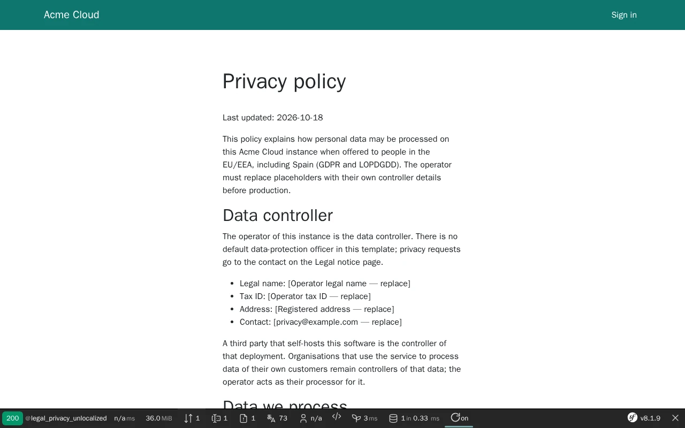
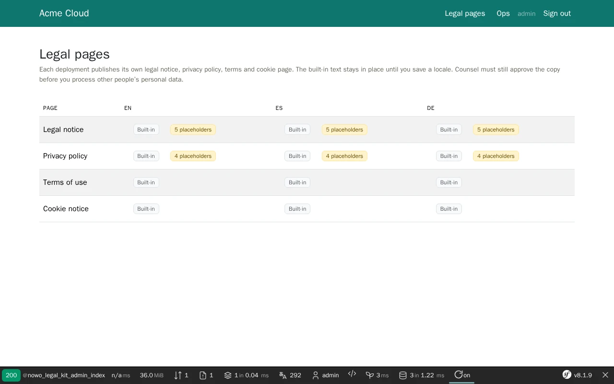

# Legal Kit Bundle

[](https://github.com/nowo-tech/LegalKitBundle/actions/workflows/ci.yml) [](https://packagist.org/packages/nowo-tech/legal-kit-bundle) [](https://packagist.org/packages/nowo-tech/legal-kit-bundle) [](LICENSE) [](https://php.net) [](https://symfony.com) [](https://github.com/nowo-tech/LegalKitBundle) [](#tests-and-coverage)

> ⭐ **Found this useful?** [Install from Packagist](https://packagist.org/packages/nowo-tech/legal-kit-bundle) · Give it a **star** on [GitHub](https://github.com/nowo-tech/LegalKitBundle) so more developers can find it.

**Legal Kit Bundle** — operator-editable legal pages for Symfony: legal notice, privacy policy, terms and cookie notice
per locale, a generic GDPR / LSSI seed in 7 languages, a placeholder gate for deploys, ops-seed portability, a DOM
allowlist sanitiser and admin pages on the UiKit page contract. One package instead of a `src/Shared/Legal` copy in
every application.

> 📋 **Compatible with Symfony 7.4+ and 8.0–8.1+** — PHP 8.3+ (Symfony 8.x requires PHP 8.4+).


This bundle is **FrankenPHP worker mode friendly**. See [docs/FRANKENPHP-WORKER-AUDIT.md](docs/FRANKENPHP-WORKER-AUDIT.md).

## Features



- **Four canonical pages** (notice, privacy, terms, cookies) plus any extra slug, on stable routes `legal_<slug>`
  (`/{_locale}/legal/<path>`); the default locale on the bare `/legal/<path>` (`legal_<slug>_unlocalized`, 301 from
  `/{default}/…`) or every locale prefixed (`routing.default_locale_style: prefixed`)
- **Operator editor** (`ROLE_ADMIN`): page × locale matrix with Built-in / Custom badges, last editor and placeholder
  hits; one tab per locale; CKEditor 5 or a plain textarea; restore the built-in text through the UiKit confirm dialog
- **Generic seed in 7 locales** (en, es, de, nl, fr, it, pt) without any company identity (REQ-CC-011); hosts override
  keys, templates or register their own seed provider
- **Placeholder gate**: `nowo:legal-kit:check-placeholders` exits 1 while a published page still contains a seed
  marker or an unresolved `%token%` — run it in your deploy pipeline; the same hits in an Ops banner partial
- **Tokens** resolved at render time only (`%brand%`, `%last_updated%`, `%cookie_inventory%`, your own resolvers) —
  the editor keeps them
- **One strict sanitiser**: DOM allowlist (no `style`, no scripts / embeds / SVG, safe URL schemes, `rel="noopener"`),
  optional CKEditor strict first pass and OutboundUrlGuard (no private-network links), on every write **and** render
- **Ops-seed portability**: export / normalise / apply `legal_documents[]` in the host transaction, `adapt-seed` to
  build a fleet's identity from the seed, `export` / `import` commands
- **Soft integrations**: CookieConsent (no modal auto-open on legal pages, privacy link, inventory table), SeoKit
  (title, canonical, hreflang, sitemap), AuditKit (timestamps, blame, action log), RoutingKit twins
- **Adopts existing tables**: maps the `legal_document` table of the apps it replaces as is — no data migration
- **FrankenPHP worker mode** friendly; no JavaScript on public pages

## Installation

```bash
composer require nowo-tech/legal-kit-bundle
```

```php
// config/bundles.php (Flex does it for you)
return [
    Nowo\AuditKitBundle\NowoAuditKitBundle::class => ['all' => true],
    Nowo\UiKitBundle\NowoUiKitBundle::class => ['all' => true],
    Nowo\FormKitBundle\NowoFormKitBundle::class => ['all' => true],
    Nowo\LegalKitBundle\NowoLegalKitBundle::class => ['all' => true],
];
```

Create the table (`bin/console doctrine:migrations:diff` then `migrate`) — or keep yours if you adopt the bundle from
a legal copy; see [docs/INSTALLATION.md](docs/INSTALLATION.md).

## Quick start

1. Configure the locales and import the routes:

```yaml
# config/packages/nowo_legal_kit.yaml
nowo_legal_kit:
    locales: '%app.locales%'          # or [en, es]
    default_locale: '%kernel.default_locale%'
    brand_name: 'Acme Cloud'

# config/routes/nowo_legal_kit.yaml
nowo_legal_kit:
    resource: .
    type: nowo_legal_kit
```

2. Keep the public pages anonymous and the admin private:

```yaml
# config/packages/security.yaml
security:
    access_control:
        - { path: ^/(?:[a-z]{2}(?:_[A-Z]{2})?/)?legal/, roles: PUBLIC_ACCESS }
        - { path: ^/admin/legal, roles: ROLE_ADMIN }
```

3. Put the legal links in your footer and the gate in your deploy:

```twig
{{ include('@NowoLegalKitBundle/_footer_nav.html.twig') }}
```

```bash
bin/console nowo:legal-kit:check-placeholders   # exit 1 until every placeholder is replaced
```

Then open **/admin/legal**, replace the bracketed placeholders in every locale and have counsel review the text.

## Requirements

- PHP `>=8.3 <8.6`, `ext-dom`
- Symfony 7.4, 8.0 and 8.1+ (FrameworkBundle, TwigBundle, Form, Validator, Security for the admin)
- Doctrine ORM 3 + DoctrineBundle; `nowo-tech/audit-kit-bundle` ^1.7 (user class configured),
  `nowo-tech/ui-kit-bundle` ^2.4, `nowo-tech/form-kit-bundle` ^2.12
- Optional: `nowo-tech/cookie-consent-bundle` ^1.17, `nowo-tech/ckeditor5-editor-bundle` ^1.9,
  `nowo-tech/outbound-url-guard-bundle` ^1.2, `nowo-tech/seo-kit-bundle` ^1.14, `nowo-tech/routing-kit-bundle` ^1.10

### Version information

| Version | PHP | Symfony | Status |
| --- | --- | --- | --- |
| 1.x | 8.3 – 8.5 | 7.4, 8.0, 8.1+ | Supported (bug and security fixes) |

## Configuration

Every key with its default is in [docs/CONFIGURATION.md](docs/CONFIGURATION.md): page catalogue, URL style, seed
fallback locale and materialise mode, editor, sanitiser allowlist, placeholder markers, cache headers, admin UI and
security, integrations, console aliases and the table prefix.

## Demo

A Symfony 8.1 demo runs on FrankenPHP (worker mode by default) with MySQL, CookieConsent and CKEditor 5:

```bash
make -C demo up
# Demo started at: http://localhost:8167
```

Sign in as **admin** / **admin** to edit the pages. See [docs/DEMO-FRANKENPHP.md](docs/DEMO-FRANKENPHP.md).
Playwright end-to-end tests and the README screenshots: `make -C demo/symfony8 test-e2e` and
`make -C demo/symfony8 demo-screenshots`.



## Documentation

- [Installation](docs/INSTALLATION.md)
- [Configuration](docs/CONFIGURATION.md)
- [Usage](docs/USAGE.md)
- [Templates (UiKit page contract)](docs/TEMPLATES.md)
- [Contributing](docs/CONTRIBUTING.md)
- [Code of Conduct](CODE_OF_CONDUCT.md)
- [Changelog](docs/CHANGELOG.md)
- [Upgrading](docs/UPGRADING.md)
- [Release](docs/RELEASE.md)
- [Security](docs/SECURITY.md)
- [Engram](docs/ENGRAM.md)
- [Spec-driven development](docs/SPEC-DRIVEN-DEVELOPMENT.md)
- [GitHub Spec Kit](docs/SPEC-KIT.md)

### Additional documentation

- [Architecture](docs/ARCHITECTURE.md)
- [PSR evaluation](docs/PSR.md)
- [Coverage policy](docs/COVERAGE.md)
- [Demo FrankenPHP](docs/DEMO-FRANKENPHP.md)
- [FrankenPHP worker audit](docs/FRANKENPHP-WORKER-AUDIT.md)
- [GitHub CI](docs/GITHUB_CI.md)
- [GitHub About](docs/GITHUB.md)

## Tests and coverage

- Tests: PHPUnit (unit, integration, functional, page contract, schema adoption), Playwright (demo e2e)
- PHP: 100%
- TS/JS: N/A
- Python: N/A

PHP line coverage: **100%** of includable `src/` (gate **≥ 99%**; strict gate `make test-coverage-100`).

```bash
make test
make test-coverage
make qa
```

## License

MIT © 2026 Héctor Franco Aceituno / Nowo.tech
